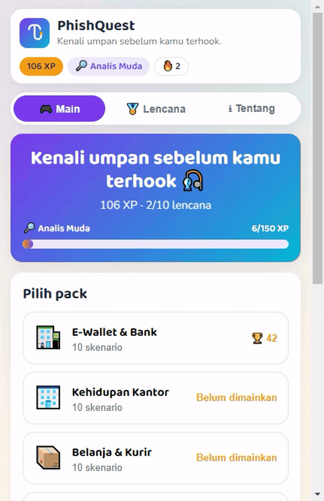
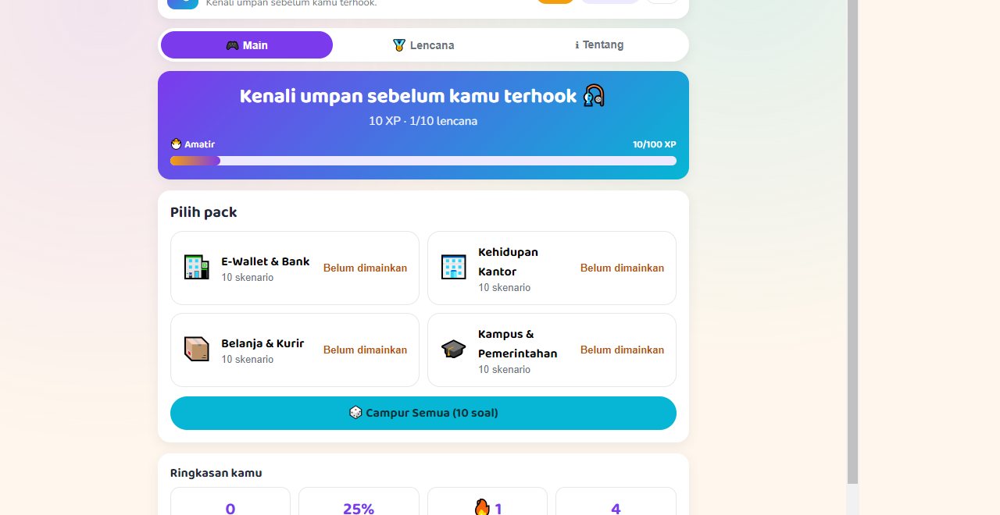
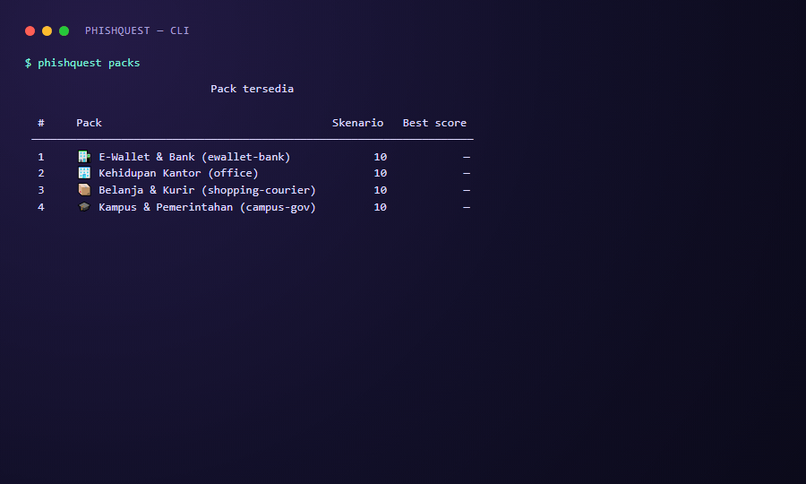

# 🎣 PhishQuest

> **Spot the bait before you get hooked.**


PhishQuest is an Indonesian-language anti-phishing education game. Players read simulated
emails, SMS, and WhatsApp messages — a suspicious Rp2,400,000 bank transaction, a held
parcel, a fake scholarship — then decide whether the message is **phishing or legit**,
pick the **best action**, or **point at the red flag**. Every answer returns instant
feedback: highlighted red flags, a plain-language explanation, and how to verify safely.

One JSON content source powers two interfaces: a **static web app** (no framework, no
build step) and a **Python CLI** built with Rich.

[Dokumentasi Bahasa Indonesia](README.md) · [PRD](docs/PRD.md) ·
[API spec](docs/api-specification.md)

---



## Play

### Web

**Live demo:** <https://cingmen.github.io/phisquest/>



Run locally:

```bash
python -m http.server 8000
# open http://localhost:8000/web/
```

Pure HTML/CSS/JS. No bundler, no JS dependencies (only Google Fonts). The GitHub Pages
workflow assembles `web/` plus `content/` on every push to `main`.

### CLI



```bash
pipx install ./cli
phishquest play --pack ewallet-bank
phishquest stats
phishquest badges
```

Progress lives in `~/.phishquest/progress.json`, written atomically. Nothing is sent
over the network.

## Content

Four packs × ten scenarios: 🏦 E-Wallet & Bank, 🏢 Office Life, 📦 Shopping & Courier,
🎓 Campus & Government. All messages use fictional brands (BankNusa, DompetKu, TokoKilat,
KargoCepat, KampusNusantara, SIBANTAR, AsurKita, LapakRia) and cover all 12 red-flag
categories.

> For v1.0 the game content and UI are Indonesian by design (D4 in the PRD); English UI
> strings are planned for v2.

## Scoring

Correct answer +10 XP, streak bonus `min((streak−1)×2, 10)`, wrong answer 0 XP and the
streak resets. Five levels at 0 / 100 / 250 / 450 / 650 XP and ten badges. The rules live
in `cli/src/phishquest/engine.py` and `web/js/engine.js`, which are held to the same
shared golden fixture (`tests/fixtures/golden.json`).

## Development

```bash
python scripts/validate_content.py content/
pip install -e "cli/[test]"
ruff check --config cli/pyproject.toml cli/ scripts/ tests/
python -m pytest tests/
node --test web/test/*.test.js
```

## Time Attack & local leaderboard (v1.1)

- **⏱️ Time Attack** — 10 mixed questions, 20 seconds each. Correct answers earn up to +5 XP
  speed bonus; running out of time counts as wrong and resets the streak.
- **🏆 Local leaderboard** — the 10 best sessions per device (score, accuracy, mode, pack) in
  web `localStorage` and `~/.phishquest/leaderboard.json` for the CLI. No backend, no account.
- CLI: `phishquest play --mode time-attack` and `phishquest leaderboard`.

## Mixed mode with question count & scenario editor (v1.1 – v1.5)

- **🎲 Campur Semua** — pick 5, 10, 20, or 40 questions. A count below 1 is rejected
  (`INVALID_COUNT`/exit 2); requests above the pool size are capped to what is available.
- **🛠️ Scenario editor** — paste one scenario, an array, or a full JSON pack. Validation uses
  the same rules as `validate_content.py`, then saves to the device (`pq_custom_packs_v1`),
  plays from the menu, or exports a pack JSON file. No backend, no account.
- **📦 Pack readiness** — exports use the full pack schema (`schema_version`, `description`,
  `emoji`), and each local pack shows either *content-ready* or the list of unmet rules:
  10 scenarios, 7/2/1 type mix, 3/4/3 difficulty, channels, 6:4 phishing:legit, ≥7 red-flag
  coverage, and id prefix. The rules match the content validator (v1.2).
- **🗂️ One pack, many scenarios (v1.3)** — a scenario list with add, rename, delete and
  move up/down, plus a per-scenario form (sender, body, link, answer options, red flags,
  explanation). Switching scenarios keeps unsaved input, changes persist once every scenario is
  valid and survive a reload, and exports include every scenario in the pack. Raw JSON stays
  available under *Import*.
- **🎯 Pick a `pack_id` & safe drafts (v1.4)** — choose one of the four content pack IDs (or type
  your own) from a dropdown; *Align id prefix* renumbers scenario ids so a pack built from scratch
  can reach **content-ready**, and export refuses an unknown `pack_id` with a clear reason. Input
  that is not valid yet is kept in a separate on-device draft, so it survives a reload without
  overwriting the valid, playable pack.
- **🛡️ Pack IDs never overwrite each other (v1.5)** — when the chosen pack ID is already used by
  another pack on this device, the editor explains the clash and leaves that pack untouched while
  keeping your input as a draft. Drafts that are not yet a valid pack appear on the menu with a
  **Resume draft** button.
- **🗑️ Delete one pack & duplicate a scenario (v1.6)** — every saved pack has a **Delete** button
  with a confirmation that names the pack; editor drafts (including drafts that came from that
  pack) stay intact. In the editor, **⧉** copies the selected scenario with the next id for the
  pack prefix, so the copy is immediately valid and ready to edit. Since v1.6.1 deletion is truly
  permanent: autosave never recreates a pack, and drafts whose source pack is gone are marked
  **“pack sumber sudah dihapus”** — the work stays safe, but only an explicit **Save scenario**
  brings the pack back to the playable list. Since v1.6.2 the marker also applies to older drafts
  created before v1.6.1.
- **📝 Drafts managed from the editor & a shortcut (v1.6.3)** — the editor lists every draft with its
  status (including “pack sumber sudah dihapus” and “isinya sama dengan pack tersimpan”) plus
  **Resume**/**Discard** buttons, and **Alt+D** duplicates the open scenario without disturbing text
  fields.
- **🔀 Cross-tab safe drafts (v1.6.4)** — drafts carry an `updated_at` stamp; a tab holding older
  content never overwrites a newer draft, and the editor offers **Load latest version** or
  **Overwrite with this tab's version**. The draft list is sorted newest-first, and Alt+D is ignored
  while a dropdown has focus.
- **🗑️ Draft deleted in another tab (v1.6.5)** — when the draft open in this tab is deleted
  elsewhere, the editor says so and stops silently recreating it; the content stays safe and can be
  restored with **Save back as draft**.
- CLI: `phishquest play --jumlah 20` (mixed, 5–40) or `--pack ID --jumlah N` (5–10).

## Ethics & legal

> PhishQuest is an educational simulation. Every email, brand, and domain in it is
> fictional. No data is collected.

- Never sends real email/SMS/WhatsApp messages and never harvests credentials.
- No accounts, no tracking cookies, no analytics; progress stays on the device.
- Content teaches recognition only — it is not a phishing template.
- MIT licensed, aligned with Indonesia's ITE Law and PDP Law No. 27/2022 (data
  minimization, no data leaves the device).
