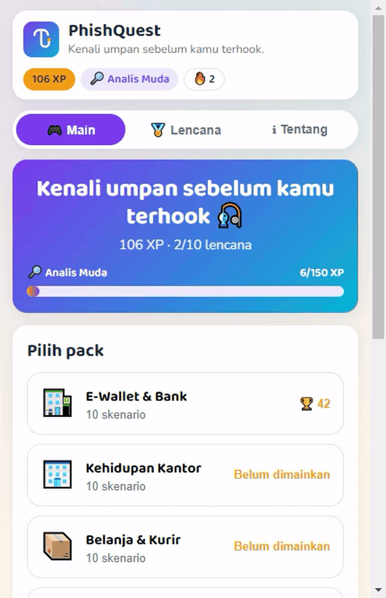
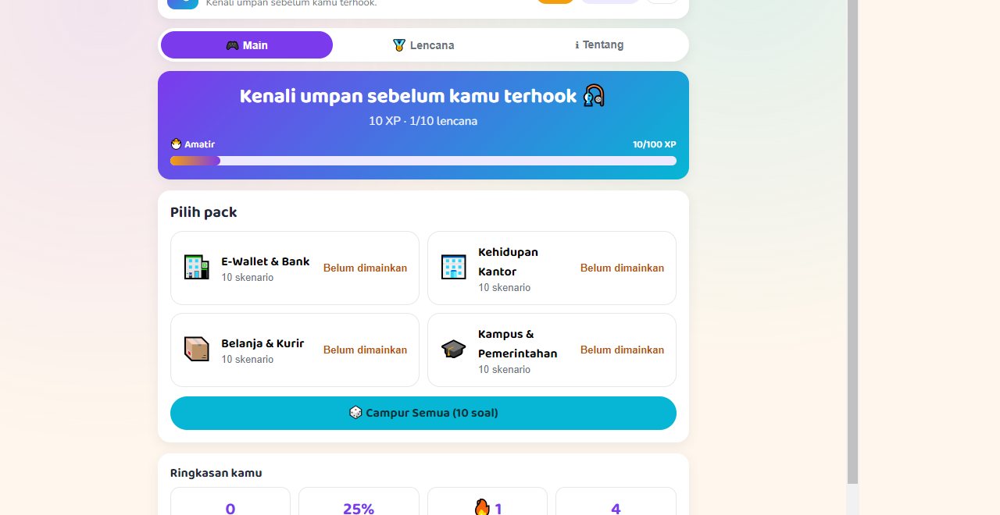
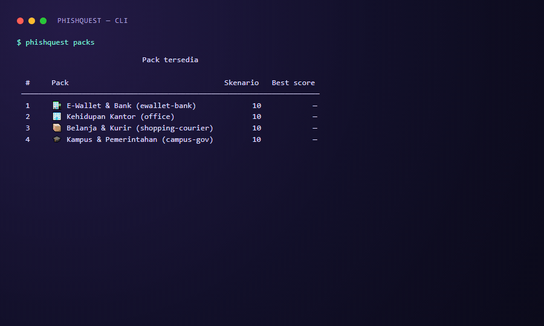

# 🎣 PhishQuest

> **Kenali umpan sebelum kamu terhook.**


PhishQuest adalah game edukasi anti-phishing berbahasa Indonesia. Pemain membaca pesan
yang meniru email, SMS, dan WhatsApp — transaksi bank mencurigakan, paket tertahan,
undangan beasiswa — lalu memutuskan apakah pesan itu **phishing atau legit**, memilih
**tindakan terbaik**, atau menunjuk **red flag** yang paling mencurigakan.

Setiap jawaban mendapat umpan balik seketika (penjelasan red flag + cara verifikasi),
plus XP, streak, level, dan lencana. Satu sumber konten JSON dipakai dua antarmuka:
**web statis** (tanpa build step) dan **CLI Python** (Rich).

[English version](README.en.md) · [PRD](docs/PRD.md) · [API](docs/api-specification.md) ·
[Skema data](docs/database-schema.md) · [Rencana implementasi](docs/implementation-plan.md)

---



## Cara main

### Web (tanpa install)

**Demo live:** <https://cingmen.github.io/phisquest/>



Menjalankan lokal:

```bash
python -m http.server 8000
# buka http://localhost:8000/web/
```

Web hanya butuh HTML/CSS/JS murni: tidak ada framework, tidak ada bundler, tidak ada
dependensi JavaScript eksternal (hanya Google Fonts). Untuk GitHub Pages, workflow
`.github/workflows/pages.yml` menyalin `web/` + `content/` lalu menerbitkannya otomatis
saat push ke `main`.

### CLI



```bash
pipx install ./cli        # atau: pip install ./cli
phishquest                # menu interaktif
phishquest play --pack ewallet-bank
phishquest play --jumlah 5 --difficulty sulit --seed 42
phishquest stats
phishquest badges
phishquest export cadangan.json
phishquest reset --yes
```

Progres CLI tersimpan di `~/.phishquest/progress.json` (tulis atomik). Tidak ada data
yang dikirim ke jaringan.

## Pack konten

| Pack | Emoji | Isi | Skenario |
|------|-------|-----|----------|
| `ewallet-bank` | 🏦 | E-Wallet & Bank | 10 |
| `office` | 🏢 | Kehidupan Kantor | 10 |
| `shopping-courier` | 📦 | Belanja & Kurir | 10 |
| `campus-gov` | 🎓 | Kampus & Pemerintahan | 10 |

Empat puluh skenario, semua bahasa Indonesia, dengan 12 jenis red flag dan brand fiktif
(BankNusa, DompetKu, TokoKilat, KargoCepat, KampusNusantara, SIBANTAR, AsurKita,
LapakRia).

## Aturan skor

| Komponen | Nilai |
|----------|-------|
| Jawaban benar | +10 XP |
| Bonus streak | +2 × (streak−1), maks +10 |
| Jawaban salah | 0 XP, streak kembali 0 |
| Level | Amatir 0 · Analis Muda 100 · Analis 250 · Detektif 450 · PhishHunter 650 |
| Lencana | 10 lencana (lihat tab **Lencana**) |

Streak, XP, dan lencana dihitung di engine (`cli/src/phishquest/engine.py` dan
`web/js/engine.js`) — UI tidak pernah menghitung sendiri.

## Struktur repo

```text
content/     satu-satunya sumber skenario (manifest, schema, 4 pack JSON)
web/         aplikasi statis: index.html, css/, js/, test/, assets/
cli/         paket Python `phishquest` (pyproject.toml, src/phishquest/)
tests/       test pytest + fixtures/golden.json (kontrak web ↔ CLI)
scripts/     validate_content.py (dijalankan CI)
docs/        PRD, API, skema database, rencana implementasi, aturan kode
```

## Pengembangan

Prasyarat: Python ≥ 3.10, Node ≥ 22 (hanya untuk test engine JS).

```bash
python scripts/validate_content.py content/         # validator konten
pip install -e "cli/[test]"                          # paket + pytest
ruff check --config cli/pyproject.toml cli/ scripts/ tests/
python -m pytest tests/                              # unit + golden test Python
node --test web/test/*.test.js                       # golden test JavaScript
```

`tests/fixtures/golden.json` dipakai **kedua** bahasa; nilai `expected` harus identik di
`engine.py` dan `engine.js`. Golden test inilah yang mencegah aturan main bercabang.

## Kontribusi konten

1. Ubah atau tambah skenario di `content/packs/*.json` mengikuti
   `content/schema/scenario.schema.json`.
2. Gunakan brand fiktif dari whitelist (`docs/coding-rules.md` §6.2). Domain phishing
   harus jelas palsu dan tidak boleh menyentuh domain resmi whitelist.
3. Jalankan `python scripts/validate_content.py content/` — semua temuan `ERROR` wajib nol.
4. Buka pull request; CI menjalankan lint, test, golden test, dan validasi konten.

Setiap pack target: ≥7 `phish_or_legit`, ≥2 `best_action`, ≥1 `spot_redflag`,
3 mudah/4 sedang/3 sulit, dan keseimbangan 6 phishing : 4 legit.

## Mode Time Attack & papan skor lokal (v1.1)

- **⏱️ Time Attack** — 10 soal campur, 20 detik per soal. Jawaban benar dapat bonus kecepatan
  hingga +5 XP; lewat batas waktu dihitung salah dan streak kembali 0.
- **🏆 Papan skor lokal** — 10 sesi terbaik per perangkat (skor, akurasi, mode, pack) di
  `localStorage` web dan `~/.phishquest/leaderboard.json` di CLI. Tanpa backend dan tanpa akun.
- CLI: `phishquest play --mode time-attack` dan `phishquest leaderboard`.

## Mode Campur berjumlah soal & editor skenario (v1.1 – v1.5)

- **🎲 Campur Semua** — pilih 5, 10, 20, atau 40 soal. Jumlah < 1 ditolak (`INVALID_COUNT`/
  exit 2) dan permintaan melebihi isi pool dipotong ke jumlah soal yang tersedia.
- **🛠️ Editor skenario** — tempel satu skenario, array, atau pack JSON. Validasi memakai aturan
  yang sama dengan `validate_content.py`, lalu simpan di perangkat (`pq_custom_packs_v1`),
  mainkan dari menu, atau ekspor sebagai berkas JSON pack. Tanpa backend dan tanpa akun.
- **📦 Kesiapan pack** — ekspor memakai skema pack lengkap (`schema_version`, `description`,
  `emoji`), dan setiap pack lokal diberi status *siap konten* atau daftar alasan yang belum
  terpenuhi: 10 skenario, komposisi tipe 7/2/1, kesulitan 3/4/3, kanal, 6:4 phishing:legit,
  cakupan ≥7 red flag, serta prefix id. Aturannya sama dengan validator konten (v1.2).
- **🗂️ Satu pack, banyak skenario (v1.3)** — daftar skenario dengan tombol tambah, ganti judul,
  hapus, dan naik/turun urutan, plus form isian per skenario (pengirim, isi pesan, tautan,
  pilihan jawaban, red flag, penjelasan). Berpindah skenario tidak menghilangkan isian lain,
  perubahan tersimpan setelah semua skenario valid dan tetap ada setelah reload, dan ekspor
  memuat seluruh skenario pack. JSON mentah tetap tersedia lewat bagian *Impor*.
- **🎯 Pilih `pack_id` & draft aman (v1.4)** — pilih salah satu dari empat ID pack konten (atau isi
  bebas) lewat dropdown; tombol *Selaraskan prefix id* menomori ulang id skenario agar pack buatan
  sendiri bisa mencapai status **siap konten**, dan ekspor menolak `pack_id` tak dikenal dengan
  alasan yang jelas. Isian yang belum valid disimpan sebagai draft terpisah di perangkat sehingga
  tetap ada setelah reload tanpa menimpa pack valid yang bisa dimainkan.
- **🛡️ ID pack tak saling menimpa (v1.5)** — bila ID pack yang dipilih sudah dipakai pack lain di
  perangkat, editor menjelaskan bentroknya dan tidak menimpa pack itu; isian tetap tersimpan sebagai
  draft. Draft yang belum jadi pack valid muncul di menu dengan tombol **Lanjutkan draft**.
- CLI: `phishquest play --jumlah 20` (Campur, 5–40) atau `--pack ID --jumlah N` (5–10).

## Etika & legal

> PhishQuest adalah simulasi edukasi. Semua email, brand, dan domain di dalamnya fiktif.
> Tidak ada data yang dikumpulkan.

- Tidak mengirim email/SMS/WhatsApp sungguhan dan tidak memanen kredensial.
- Tidak ada akun, email, cookie pelacak, atau analytics; progres tersimpan lokal.
- Konten hanya untuk mengenali pola penipuan — bukan template untuk membuat phishing.
- Dirilis dengan lisensi [MIT](LICENSE), selaras semangat UU ITE dan UU PDP No. 27/2022
  (data minimization, tanpa transfer data keluar perangkat).
