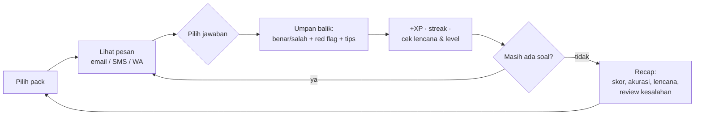
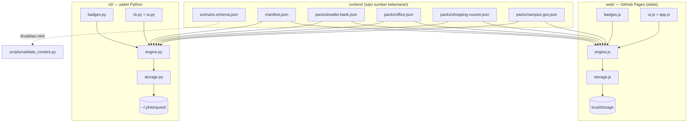
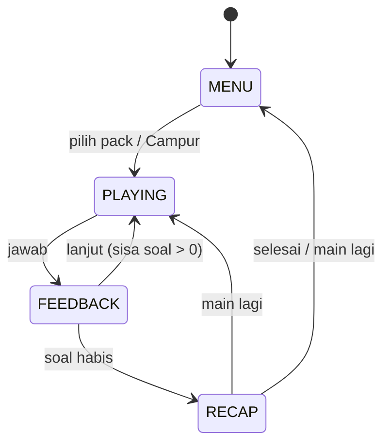

# 📋 PRD — PhishQuest

> **Product Requirements Document · "Bintang Utara" proyek.**
> Semua keputusan pembangunan PhishQuest harus konsisten dengan dokumen ini.
> Jika kode bertentangan dengan PRD, PRD yang menang sampai PRD direvisi lewat pull request.

| | |
|---|---|
| Nama produk | **PhishQuest** |
| Tagline | "Kenali umpan sebelum kamu terhook." 🎣 |
| Versi dokumen | 1.0.0 |
| Status | Terkunci untuk pengembangan v1.0 |
| Target rilis | v1.2.0 (dirilis; riwayat di `implementation-plan.md`) |
| Terakhir diperbarui | 2026-11-03 |
| Bahasa konten | Indonesia (UI & skenario); README dwibahasa (ID/EN) |

---

## 1. Ringkasan Eksekutif

**PhishQuest** adalah game edukasi anti-phishing berbahasa Indonesia yang dimainkan seperti kuis bergaya arcade. Pemain disajikan pesan-pesan yang meniru email, SMS, dan WhatsApp — mulai dari "transaksi mencurigakan Rp2.400.000" dari m-banking, paket tertahan dari kurir, sampai undangan beasiswa — lalu memilih apakah pesan itu **phishing atau legit**, atau memilih **tindakan terbaik** dari beberapa opsi.

Setiap jawaban diberi umpan balik seketika: penjelasan *red flag* yang ditandai pada pesan, tips cara verifikasi yang benar, plus poin XP, *streak*, level, dan lencana. Di akhir sesi muncul layar **recap** yang merangkum skor, akurasi, lencana baru, dan daftar kesalahan untuk ditinjau ulang.

Produk ini dijalankan dalam **dua antarmuka dari satu sumber konten yang sama** (file JSON skenario):

1. **Web** — HTML/CSS/JS murni tanpa framework dan tanpa build step, di-host gratis di **GitHub Pages**, bisa dimainkan langsung dari link demo.
2. **CLI** — paket Python (`pipx install phishquest`) bertampilan Rich, nyaman dipakai di terminal dan cocok untuk demo portofolio.

**Pembeda dari Google Phishing Quiz:** konten lokal Indonesia yang realistis (m-banking, kurir, beasiswa, pajak), gamifikasi lebih dalam (XP, level, lencana, streak), dan ketersediaan versi CLI.

## 2. Latar Belakang & Masalah

1. **Phishing adalah pintu masuk serangan paling umum** bagi pengguna awam di Indonesia: penipuan m-banking, OTP palsu, kurir menahan paket, beasiswa fiktif, hingga "pembaruan data" berkedok instansi.
2. **Pelatihan security awareness yang ada mahal, berbahasa Inggris, dan membosankan** — sulit dijangkau mahasiswa, komunitas, dan pengguna umum.
3. **Google Phishing Quiz bagus tetapi** berbahasa Inggris, kontennya tidak kontekstual Indonesia, dan gamifikasinya dangkal (sekadar skor akhir).
4. **Butuh portofolio cybersecurity yang aman dipublikasikan**: proyek phishing umumnya berisiko (mengirim email sungguhan, memanen kredensial). PhishQuest di-desain sejak awal 100% simulasi edukatif sehingga aman dan legal untuk repo publik.

## 3. Tujuan & Sasaran

| # | Tujuan | Sasaran terukur (v1.0) |
|---|--------|------------------------|
| T1 | Melatih pengenalan red flag phishing | ≥ 12 jenis red flag tercakup; setiap skenario punya penjelasan edukatif |
| T2 | Pengalaman bermain yang seru | XP, 5 level, 10 lencana, streak, recap lengkap di web & CLI |
| T3 | Konten kontekstual Indonesia | 4 pack × 10 skenario = **40 skenario**, semua bahasa Indonesia |
| T4 | Mudah diakses siapa saja | Demo web live di GitHub Pages, tanpa install; CLI tersedia via `pipx` |
| T5 | Portofolio berkualitas | README dwibahasa + GIF demo, CI hijau, lisensi MIT, struktur kode rapi |

## 4. Batasan Produk — yang TIDAK dikerjakan (Non-Goals)

Batasan ini **wajib** dipatuhi agar proyek tetap etis, aman, dan rampak:

1. ❌ **Tidak mengirim email/SMS/WhatsApp sungguhan** ke siapa pun — tidak ada integrasi SMTP/API pesan.
2. ❌ **Tidak memanen kredensial** — tidak ada form yang "menerima" password/OTP, bahkan untuk demo.
3. ❌ **Tidak melakukan serangan nyata** — tidak ada scanning, eksploitasi, atau pengujian terhadap sistem pihak lain.
4. ❌ **Tidak memakai brand/logo/nama perusahaan atau instansi nyata** sebagai pengirim — semua fiktif (lihat whitelist di `coding-rules.md` §6).
5. ❌ **Tidak ada akun/login, tidak ada data pribadi** — tanpa registrasi, tanpa email, tanpa cookie pelacak; progres tersimpan lokal di perangkat pemain.
6. ❌ **Tidak ada backend di v1.0** — web murni statis; leaderboard online (opsional) baru di v2.
7. ❌ **Tidak ada iklan, analytics pihak ketiga, atau tracking.**
8. ❌ **Tidak menjadi alat pembuat phishing** — konten hanya contoh simulasi untuk dikenali, bukan template untuk disalahgunakan.

## 5. Pengguna Sasaran & Persona

| Persona | Deskripsi | Kebutuhan utama |
|---|---|---|
| **P1 — Rina, mahasiswa** (18–25) | Belajar cybersecurity otodidak, aktif di komunitas, main via HP | Cara belajar yang seru, gratis, tanpa install, bahasa Indonesia |
| **P2 — Pak Dengklek, pengajar pelatihan** (30–50) | Guru/trainer yang butuh materi praktik awareness | Materi siap pakai, versi CLI untuk lab, skenario realistis untuk diskusi kelas |
| **P3 — Rekruter/developer** | Menilai kualitas repo portofolio | Kode bersih, test, CI, dokumentasi, demo langsung bisa diklik |

## 6. Keputusan Desain Terkunci

Keputusan berikut **sudah final** dan tidak perlu ditanyakan ulang saat pengembangan:

| # | Dimensi | Keputusan |
|---|---------|-----------|
| D1 | Platform | **Web + CLI** dari satu sumber konten JSON bersama |
| D2 | Format permainan | Kuis **"Phishing atau Legit"** + soal **"pilih tindakan terbaik"** + soal **"temukan red flag"** (3 tipe) |
| D3 | Gamifikasi | **Lengkap**: XP, 5 level, streak, 10 lencana, progress bar, layar recap |
| D4 | Bahasa | Konten & UI **bahasa Indonesia**; README **dwibahasa** (ID/EN); struktur siap i18n untuk v2 |
| D5 | Tema pack | 4 pack: E-Wallet & Bank 🏦 · Kehidupan Kantor 🏢 · Belanja & Kurir 📦 · Kampus & Pemerintahan 🎓 |
| D6 | Nama | **PhishQuest** |
| D7 | Gaya visual web | **Arcade ceria**: warna terang, emoji, kartu membulat, konfeti saat naik level |

## 7. Konsep Game

### 7.1 Core Loop



Setiap putaran loop memakan waktu 30–60 detik; satu sesi (10 soal) selesai dalam 5–8 menit — pas untuk main sambil santai maupun dipakai di kelas.

### 7.2 Tipe Soal

| Tipe | `type` | Cara menjawab | Contoh |
|------|--------|---------------|--------|
| Phishing atau Legit | `phish_or_legit` | Pilih **Phishing** 🎣 atau **Legit** ✅ | Email "akun akan diblokir 1×24 jam" dari `banknusa-secure.example` |
| Tindakan Terbaik | `best_action` | Pilih 1 dari 3–4 opsi tindakan | SMS Dukcapil palsu minta cek data via link → pilih "abaikan, verifikasi via kanal resmi" |
| Temukan Red Flag | `spot_redflag` | Pilih 1 bagian pesan yang paling mencurigakan | Lampiran `invoice.pdf.exe` di antara bagian lain yang wajar |

Distribusi minimal per pack: **≥ 7** `phish_or_legit`, **≥ 2** `best_action`, **≥ 1** `spot_redflag`.

### 7.3 Skema XP, Level, dan Streak

**Perolehan XP:**

| Sumber | Nilai | Ketentuan |
|--------|-------|-----------|
| Jawaban benar | **+10 XP** | Dasar untuk semua tipe soal |
| Bonus streak | **+2 × (streak−1)**, maks **+10** | Streak = jawaban benar beruntun; soal ke-1 beruntun tanpa bonus, ke-2 +2, ke-3 +4, dst., mentok di +10 |
| Bonus kecepatan | maks **+5** | Hanya mode Terbatas Waktu (v1.1) |
| Jawaban salah | **0 XP** | Streak kembali ke 0 |

**Level** (berdasar `total_xp` kumulatif, tidak pernah berkurang):

| Level | `id` | Ambang XP | Emoji |
|-------|------|-----------|-------|
| Amatir | `amatir` | 0 | 🐣 |
| Analis Muda | `analis_muda` | 100 | 🔎 |
| Analis | `analis` | 250 | 🕵️ |
| Detektif | `detektif` | 450 | 🧠 |
| PhishHunter | `phishhunter` | 650 | 👑 |

> Satu run sempurna 40 soal menghasilkan ±770 XP maksimum teoretis, sehingga level PhishHunter menuntut hampir tanpa cela — sengaja, agar ada target jangka panjang dan alasan bermain ulang.

**Streak** ditampilkan sebagai 🔥 dengan angka; best streak tersimpan permanen.

### 7.4 Lencana (Badges)

| `badge_id` | Nama | Emoji | Syarat |
|------------|------|-------|--------|
| `first_catch` | Tangkapan Pertama | 🎣 | Menjawab benar pertama kali |
| `streak_5` | Mata Elang | 🔥 | 5 jawaban benar beruntun |
| `streak_10` | Mantap Jiwa | 💪 | 10 jawaban benar beruntun |
| `perfect_pack` | Tanpa Terhook | 💯 | Menyelesaikan satu pack dengan akurasi 100% |
| `all_packs` | Penjelajah Nusantara | 🗺️ | Menyelesaikan ≥ 1 sesi di keempat pack |
| `domain_guard` | Detektif Domain | 🕵️ | Benar pada 10 soal ber-red-flag `DOMAIN_PALSU`/`DOMAIN_MIRIP` |
| `otp_guard` | Penjaga OTP | 🔐 | Benar pada 5 soal ber-red-flag `MEMINTA_DATA_SENSITIF` |
| `urgency_guard` | Tidak Tergesa-Gesa | ⏰ | Benar pada 5 soal ber-red-flag `TEKANAN_WAKTU` |
| `comeback` | Bangkit Lagi | 🌱 | Setelah 3 salah beruntun, menjawab benar seluruh sisa soal dalam sesi |
| `level_detective` | Naik Kelas | 🎓 | Mencapai level Detektif |

Evaluasi lencana dilakukan otomatis oleh modul `badges` (lihat `api-specification.md` §4–5) setiap jawaban dan setiap akhir sesi; hasilnya deterministik dan identik antara web dan CLI (dijamin *golden test*).

### 7.5 Layar Recap (Akhir Sesi)

Recap wajib menampilkan: skor & XP dasar sesi, bonus streak, akurasi (%), best streak, lencana baru (dengan animasi kecil), level saat ini + progress bar ke level berikutnya, dan **daftar kesalahan** yang bisa diklik untuk melihat penjelasan ulang. Web menambahkan konfeti saat pemain naik level atau dapat lencana baru.

### 7.6 Mode Permainan

| Mode | Versi | Deskripsi |
|------|-------|-----------|
| Santai (default) | v1.0 | 10 soal per sesi, tanpa tekanan waktu |
| Per Pack / Campur | v1.0 | Pilih satu pack, atau mode **Campur** yang mengocok soal dari semua pack |
| Terbatas Waktu | v1.1 | 20 detik/soal + bonus kecepatan, leaderboard lokal |

## 8. Ruang Lingkup Fitur v1.0 (MoSCoW)

| ID | Fitur | Prioritas | Deskripsi singkat |
|----|-------|-----------|-------------------|
| F1 | Skenario engine | **Must** | Memuat pack JSON, menyusun sesi, menilai jawaban, menghitung XP/streak — logika identik untuk web & CLI |
| F2 | Konten 40 skenario | **Must** | 4 pack × 10 skenario, tervalidasi skema & komposisi |
| F3 | Web app | **Must** | Statis, tanpa framework, siap GitHub Pages; layar menu → permainan → recap |
| F4 | CLI app | **Must** | Perintah `play`, `packs`, `stats`, `badges`, `export`, `reset`, `version` |
| F5 | Skoring & level | **Must** | XP, 5 level, streak sesuai §7.3 |
| F6 | Lencana | **Must** | 10 lencana sesuai §7.4 |
| F7 | Penyimpanan progres | **Must** | Web: localStorage; CLI: file JSON `~/.phishquest/`; ekspor/impor JSON |
| F8 | Recap & review kesalahan | **Must** | Sesuai §7.5 |
| F9 | Umpan balik per soal | **Must** | Penjelasan red flag + tips verifikasi setiap jawaban |
| F10 | Mode Campur | **Should** | Sesi lintas pack yang dikocok, jumlah soal dapat dipilih (5–40) |
| F11 | Validasi konten otomatis | **Should** | `scripts/validate_content.py` jalan di CI |
| F12 | Mode Terbatas Waktu + leaderboard lokal | **Won't (v1.0)** → v1.1 | Termasuk papan skor per perangkat |
| F13 | Mini editor skenario (v1.1) | **Should** | Tempel JSON → validasi klien → simpan lokal/ekspor → mainkan, tanpa backend |

## 9. Konten & Kebutuhan Data

### 9.1 Struktur Konten

```
content/
├── schema/scenario.schema.json   ← JSON Schema (draft 2020-12)
├── manifest.json                 ← daftar pack + metadata
└── packs/
    ├── ewallet-bank.json         🏦 E-Wallet & Bank
    ├── office.json               🏢 Kehidupan Kantor
    ├── shopping-courier.json     📦 Belanja & Kurir
    └── campus-gov.json           🎓 Kampus & Pemerintahan
```

Struktur field lengkap ada di `api-specification.md` §3. Ringkas: setiap skenario memiliki `id` unik, `type`, `difficulty` (mudah/sedang/sulit), `channel` (email/sms/whatsapp), identitas pengirim, isi pesan, opsi jawaban, jawaban benar, daftar `red_flags`, `explanation`, dan `teach` (tip + cara verifikasi).

### 9.2 Taksonomi Red Flag (12 jenis — enum tetap)

| Kode | Arti |
|------|------|
| `PENGIRIM_TIDAK_WAJAR` | Nama/alamat pengirim tidak sesuai saluran resmi brand |
| `DOMAIN_PALSU` | Domain pengirim/link sama sekali bukan milik brand |
| `DOMAIN_MIRIP` | Typosquatting — menyerupai domain resmi (tanda hubung, angka, TLD lain) |
| `TEKANAN_WAKTU` | Batas waktu artifisial: "1×24 jam", "hari ini juga" |
| `ANCAMAN` | Ancaman pemblokiran akun, denda, proses hukum |
| `IMBALAN_BERLEBIHAN` | Hadiah/cashback/refund yang tidak masuk akal |
| `MEMINTA_DATA_SENSITIF` | Meminta OTP, PIN, password, CVV, NIK + foto KTP |
| `LINK_MENCURIGAKAN` | `http` (bukan https), URL IP address, shortener, teks link ≠ tujuan |
| `LAMPIRAN_BERBAHAYA` | `.exe`, `.apk`, `.html`, `.js`, ekstensi ganda (`pdf.exe`) |
| `GRAMATIKA_AJANG` | Kalimat kaku, ejaan acak, format tidak resmi |
| `SAPAAN_GENERIK` | "Yth Pelanggan Yth" tanpa menyebut nama |
| `SALURAN_TIDAK_WAJAR` | Bank/kampus/instansi menghubungi via WA/SMS berisi link |

### 9.3 Aturan Konten

1. **Brand fiktif saja** — gunakan whitelist di `coding-rules.md` §6 (BankNusa, DompetKu, TokoKilat, KargoCepat, dst.). Nama brand nyata hanya boleh muncul di `teach` sebagai penjelasan umum ("pihak bank mana pun tidak pernah meminta OTP").
2. **Domain penipu jelas-jelas palsu** (mis. `banknusa-secure.example`, `dompetku-kyc.example`) dan **tidak boleh** sama dengan domain resmi whitelist; nama layanan shortener nyata (mis. `bit.ly`) boleh karena tidak mengarah ke mana pun.
3. Setiap skenario phishing memiliki **2–5 red flag**; skenario legit memiliki **0 red flag** (divalidasi otomatis).
4. Isi pesan maksimal ±120 kata; `explanation` maksimal 3 kalimat; `teach.tip` satu kalimat padat.
5. Bahasa Indonesia baku tapi natural — termasuk meniru gaya bahasa penipuan sungguhan (huruf kapital berlebihan, dsb.) karena itu bagian dari red flag `GRAMATIKA_AJANG`.
6. Tidak ada konten SARA, kekerasan grafis, atau instruksi teknis untuk membuat phishing.

### 9.4 Komposisi Target per Pack (10 skenario)

| Komponen | Target |
|----------|--------|
| Tipe soal | ≥ 7 `phish_or_legit`, ≥ 2 `best_action`, ≥ 1 `spot_redflag` |
| Kanal | ≥ 3 email, ≥ 3 SMS, ≥ 2 WhatsApp, sisa bebas |
| Kesulitan | 3 mudah, 4 sedang, 3 sulit |
| Keseimbangan | Dari soal `phish_or_legit`: 6 phishing, 4 legit |
| Cakupan red flag | Setiap pack menyentuh ≥ 7 dari 12 red flag; seluruh koleksi mencakup 12/12 |

### 9.5 Contoh Skenario Lengkap (ilustrasi format)

```json
{
  "id": "ew-001",
  "type": "phish_or_legit",
  "difficulty": "mudah",
  "channel": "email",
  "sender": { "name": "BankNusa Care", "address": "care@banknusa-secure.example" },
  "subject": "⚠️ Transaksi Mencurigakan Rp2.400.000 - Akun Akan Diblokir",
  "datetime": "2026-11-02T09:15:00+07:00",
  "body": "Yth Pelanggan Yth,\n\nKami mendeteksi transaksi mencurigakan sebesar Rp2.400.000 pada rekening Anda. Segera verifikasi identitas Anda dalam 1x24 JAM atau akun Anda akan DIBLOKIR PERMANEN dan denda Rp500.000 akan dikenakan.\n\nVerifikasi sekarang: http://banknusa-secure.example/verifikasi\n\nHormat kami,\nTim Keamanan BankNusa",
  "link": { "text": "banknusa-secure.example/verifikasi", "href": "http://banknusa-secure.example/verifikasi" },
  "attachment": null,
  "is_phish": true,
  "red_flags": ["DOMAIN_MIRIP", "TEKANAN_WAKTU", "ANCAMAN", "SAPAAN_GENERIK", "LINK_MENCURIGAKAN"],
  "explanation": "Domain asli BankNusa adalah banknusa.example, bukan banknusa-secure.example. Batas waktu 1×24 jam dan ancaman denda adalah tekanan klasik agar korban panik. Tautan memakai http, bukan https.",
  "teach": {
    "tip": "Email mengurus masalah rekening selalu bisa ditunda: tutup, lalu buka aplikasi m-banking resmi atau hubungi call center.",
    "verify_how": "Cek alamat pengirim dan domain link huruf demi huruf; putuskan transaksi lewat aplikasi resmi, bukan lewat link di email."
  }
}
```

## 10. Arsitektur Sistem



**Prinsip arsitektur:** *"Satu sumber konten, dua antarmuka, aturan main yang identik."*

1. **Konten** berupa JSON murni — menambah skenario tidak pernah menyentuh kode.
2. **Engine** (aturan XP/streak/lencana/penilaian) diimplementasi ganda: `engine.js` dan `engine.py` — keduanya wajib menghasilkan output identik untuk input sama (*golden test*, lihat `api-specification.md` §10).
3. **Penyimpanan** masing-masing lokal (localStorage / file JSON), skema sama persis (`database-schema.md`).
4. **Tidak ada backend** di v1.0; semua komputasi di sisi klien/lokal.

## 11. Pengalaman Pengguna (UX/UI)

### 11.1 Prinsip

1. **Mobile-first** — mayoritas pemain via HP; layar permainan nyata di layar 360 px.
2. **Feedback instan** — tidak ada jeda antara jawaban dan penjelasan.
3. **Ceria, bukan menakutkan** — arcade ceria dengan emoji; serius hanya pada bagian edukasi.
4. **Nol friksi** — tanpa login, tanpa tutorial panjang; "Main" harus tercapai dalam 1 klik/tap dari halaman depan.

### 11.2 Peta Layar Web

| Layar | Isi |
|-------|-----|
| **Menu** | Logo + tagline, kartu 4 pack (emoji, nama, best score), tombol "Campur Semua", total XP + level saat ini, link README/tentang |
| **Permainan** | Header: pack, skor, streak 🔥, progress bar soal ke-n/10 · Kartu pesan (email/SMS/WA) dengan sender, subjek, isi, lampiran/tautan · Area jawaban sesuai tipe soal · Panel umpan balik setelah menjawab (hijau/merah, daftar red flag, tips, tombol "Lanjut") |
| **Recap** | Sesuai §7.5 |
| **Lencana** (tab di menu) | Grid 10 lencana: terperoleh berwarna, yang belum redup dengan syaratnya |
| **Tentang** | Disclaimer etika, kredit, cara kontribusi konten |

### 11.3 Alur CLI

```text
$ phishquest play --pack ewallet-bank

╭──────────────────────────────────────────────╮
│ 🎣 PhishQuest · Pack: E-Wallet & Bank        │
│ Skor 20 · XP 130 · Streak 🔥2                │
╰──────────────────────────────────────────────╯
┌─ ✉️  Email ─────────────────────────────────────┐
│ Dari   : BankNusa Care <care@banknusa-…>     │
│ Subjek : ⚠️ Transaksi Mencurigakan Rp2.400.000│
└──────────────────────────────────────────────┘
  Yth Pelanggan Yth, kami mendeteksi transaksi
  mencurigakan ... akun akan DIBLOKIR PERMANEN ...

  Phishing atau Legit? [P/L]: P

 ✅ Benar! +10 XP (streak 🔥3)
   Red flag: DOMAIN_MIRIP · TEKANAN_WAKTU · ANCAMAN
   💡 Tutup email, buka aplikasi m-banking resmi…
 [Enter untuk lanjut →]
```

Perintah penuh dan exit code di `api-specification.md` §6.

### 11.4 Gaya Visual Web (Arcade Ceria)

| Token | Nilai | Pakai untuk |
|-------|-------|-------------|
| `--pq-bg` | `#FFF7ED` | Latar halaman (krem hangat) |
| `--pq-surface` | `#FFFFFF` | Kartu |
| `--pq-text` | `#1F2937` | Teks utama |
| `--pq-primary` | `#7C3AED` | Ungu — tombol, header kartu |
| `--pq-accent` | `#06B6D4` | Cyan — highlight, link |
| `--pq-success` | `#22C55E` | Jawaban benar |
| `--pq-danger` | `#EF4444` | Jawaban salah / tanda red flag |
| `--pq-warning` | `#F59E0B` | XP, streak, lencana |

Font: **Baloo 2** (judul) dan **Nunito** (isi) via Google Fonts dengan fallback `system-ui`. Kartu radius 16 px, chip radius penuh, animasi ≤ 200 ms dan menghormati `prefers-reduced-motion`. Palet lengkap dan aturan CSS di `coding-rules.md` §5.

### 11.5 Aksesibilitas

Kontras teks ≥ 4.5:1 · semua kontrol bisa dioperasikan keyboard (P/L shortcut di web juga) · `aria-live` untuk umpan balik · tak ada informasi yang disampaikan warna saja (selalu ada ikon + teks) · animasi dimatikan bila `prefers-reduced-motion`.

### 11.6 Pesan Etika & Disclaimer

Wajib tampil (menu/footer web, header CLI, README):

> "PhishQuest adalah simulasi edukasi. Semua email, brand, dan domain di dalamnya fiktif. Tidak ada data yang dikumpulkan."

## 12. Alur Kerja Sistem

### 12.1 Alur Bermain (end-to-end)

1. **Mulai sesi** — UI/CLI membaca `manifest.json` → validasi `schema_version` → pemain memilih pack (atau Campur) → engine memuat file pack.
2. **Susun sesi** — engine memfilter `difficulty` (opsional), mengambil 10 skenario, mengocok urutan (seed opsional agar bisa direproduksi di CLI).
3. **Loop soal** — render pesan → terima jawaban → `engine.answer()` menghitung: benar/salah, XP (dasar + bonus streak), streak baru, red flag yang tepat → UI/CLI menampilkan umpan balik → progres disimpan (debounce 300 ms di web; langsung di CLI).
4. **Cek lencana & level** — modul badges mengevaluasi counter; jika ada lencana baru atau level naik, tampilkan notifikasi.
5. **Recap** — hitung akurasi, XP sesi, lencana baru; simpan entri `history` (maks 50, FIFO); tampilkan recap; pemain bisa main lagi.



### 12.2 Alur Penambahan Konten (kontributor)

1. Kontributor menyalin file pack → menambah/mengubah skenario mengikuti skema.
2. Jalankan `python scripts/validate_content.py content/` (atau push — CI memvalidasi otomatis).
3. PR direview: kualitas red flag, bahasa, aturan brand fiktif.
4. Merge → GitHub Pages otomatis ter-deploy ulang → konten baru langsung main di web & CLI (`pip install` versi baru untuk CLI).

## 13. Keamanan, Etika & Kepatuhan

| Aspek | Kebijakan |
|-------|-----------|
| Sifat produk | Simulasi edukasi murni; tidak mensimulasikan serangan terhadap sistem nyata |
| Hukum Indonesia | Selaras dengan semangat **UU ITE** (akses ilegal Pasal 30) dan **UU PDP No. 27/2022**: proyek ini justru mengedukasi agar tidak menjadi korban, dan tidak memproses data pribadi apa pun |
| Data pribadi | **Tidak ada**. Progres tersimpan lokal perangkat; tidak ada cookie pelacak, tidak ada analytics, tidak ada permintaan izin apa pun |
| Brand | 100% fiktif (whitelist), disertai disclaimer di semua titik kontak |
| Konten phishing | Hanya sebagai bahan pengenalan pola; tidak memberikan template/instruksi pembuatan phishing |
| Repo publik | Lisensi MIT; section "Ethics & Legal" di README |

## 14. Kebutuhan Non-Fungsional

| Kategori | Target v1.0 |
|----------|-------------|
| Performa web | Halaman interaktif < 2 detik di koneksi 3G; total aset ter-gzip < 200 KB; tanpa dependensi JS eksternal |
| Kompatibilitas web | 2 versi terakhir Chrome, Firefox, Edge, Safari (desktop + mobile) |
| Kompatibilitas CLI | Python ≥ 3.10 di Linux, macOS, Windows (warna via Rich, aman di Windows Terminal) |
| Dependensi CLI | Runtime: `rich` saja. Dev: `pytest`, `ruff` |
| Offline | Web tetap jalan selama konten sudah ter-cache browser; tanpa service worker di v1 |
| Keandalan data | Penulisan progres atomik (CLI: tulis tmp + rename; web: try/catch kuota) |
| CI | Lint + test + validasi konten wajib hijau sebelum merge |
| Test | Coverage modul engine ≥ 90%; golden test kontrak web↔CLI |

## 15. Rilis & Roadmap

| Versi | Isi | Status |
|-------|-----|--------|
| **v1.0.0** | F1–F11, 40 skenario, web + CLI + Pages + README dwibahasa | Dirilis |
| **v1.1.0** | Mode Terbatas Waktu + leaderboard lokal (per perangkat), mode acak lintas pack dengan jumlah soal pilihan, mini editor skenario (impor JSON dari teks) | Dirilis (v1.1.0) |
| **v1.2.0** | Ekspor hasil editor berbentuk pack `content/` lengkap + pemeriksa kesiapan pack (10 skenario, komposisi 7/2/1 tipe, 3/4/3 kesulitan, kanal, 6:4 phishing/legit, cakupan red flag, prefix id) dengan paritas dua bahasa | Dirilis (v1.2.0) |
| **v2.0.0** | Leaderboard online opsional (FastAPI + SQLite, anonim tanpa PII — desain sudah ada di `api-specification.md` §8 dan `database-schema.md` §6), kartu bagikan skor (gambar), i18n Inggris | Ide, belum dikomit |

## 16. Metrik Keberhasilan (Checklist v1.0)

- [x] Demo web live di `https://cingmen.github.io/phisquest/` dan bisa dimainkan sampai recap
- [x] 40 skenario lolos validator tanpa error/warning
- [x] Golden test web↔CLI hijau (10 kasus uji kontrak)
- [x] Coverage engine 97%; CI hijau (4 job)
- [x] Lighthouse Performance 90, Accessibility 100
- [x] README dwibahasa dengan GIF demo (≤ 3 MB) + screenshot
- [x] `pipx install ./cli` berjalan di Windows dan semua perintah CLI berfungsi
- [x] Nol data pribadi yang dikirim keluar perangkat (review manual)

## 17. Risiko & Mitigasi

| Risiko | Dampak | Mitigasi |
|--------|--------|----------|
| Domain contoh ternyata aktif/didaftarkan orang jahat | Reputasi, penyalahgunaan | Gunakan domain jelas-jelas palsu; checklist rilis memverifikasi domain contoh tidak aktif |
| Konten edukasi keliru (mis. tips verifikasi salah) | Kredibilitas | Semua `teach` direview; rujuk praktik umum (jangan klik, verifikasi via kanal resmi) |
| Engine JS & Python berbeda perilaku | Kebingungan pemain | Golden test wajib di CI; satu fixture JSON dipakai dua bahasa |
| Scope creep (fitur v1.1 masuk v1.0) | Telat rilis | Non-goals §4 + milestone ketat di `implementation-plan.md` |
| localStorage penuh / mode privat | Progres hilang | try/catch + pesan sopan; CLI tetap alternatif penuh |
| Kehilangan momentum pengembangan | Proyek mangkrak | Milestone kecil dengan DoD jelas; setiap M selesai = bisa demo |

## 18. Dokumen Terkait

- [`api-specification.md`](api-specification.md) — kontrak data JSON, API internal, CLI interface, REST v2
- [`database-schema.md`](database-schema.md) — localStorage, file JSON CLI, konten, SQLite v2
- [`implementation-plan.md`](implementation-plan.md) — milestone M0–M5 dan checklist rilis
- [`coding-rules.md`](coding-rules.md) — gaya kode, struktur folder, aturan konten, CI

## Lampiran A — Contoh Tiga Tipe Soal

**A.1 `phish_or_legit` (legit):** Newsletter promo TokoKilat dari `noreply@tokokilat.example`, link https ke domain resmi, ada tombol unsubscribe, sapaan menyebut nama → jawaban **Legit**, 0 red flag.

**A.2 `best_action` (SMS, sulit):** SMS dari +62 811-xxx-xxx mengaku "SIBANTAR" (instansi fiktif) menyatakan data KTP bermasalah, minta cek via `http://sibantar-datalkp.example`. Opsi: (A) klik link sekarang; (B) balas SMS dengan NIK; (C) **abaikan & hapus; bila ragu, cek lewat kanal resmi instansi** ✔; (D) teruskan ke keluarga agar waspada. Red flag: `SALURAN_TIDAK_WAJAR`, `DOMAIN_PALSU`, `LINK_MENCURIGAKAN`, `ANCAMAN`.

**A.3 `spot_redflag` (email, sedang):** Invoice dari "KargoCepat" dengan isi wajar, alamat `billing@kargocepat.example`, kecuali lampiran `invoice-nov.pdf.exe` → opsi yang benar adalah lampiran tersebut. Red flag utama: `LAMPIRAN_BERBAHAYA`.
