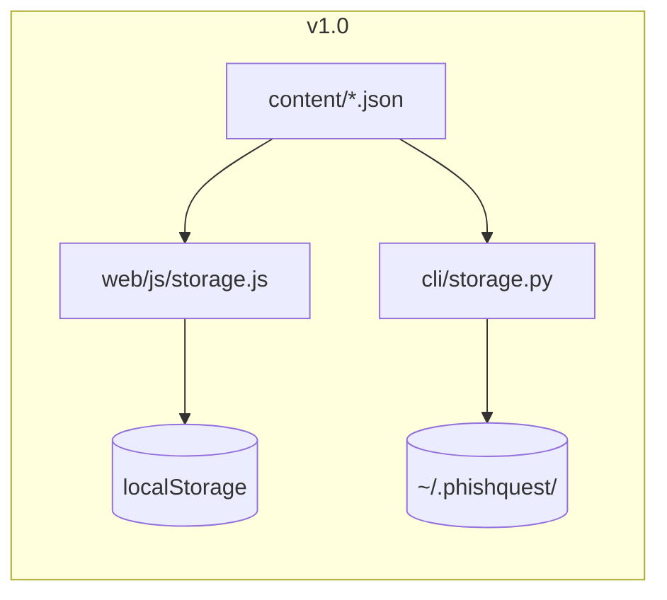
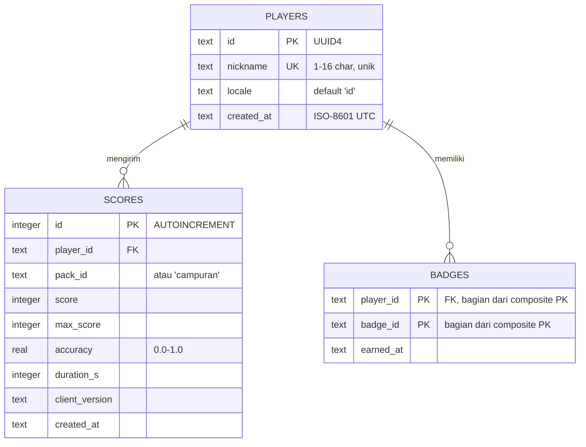

# 🗄️ Database Schema — PhishQuest

> Struktur penyimpanan data PhishQuest. Dokumen ini memastikan siapa pun (termasuk AI yang
> membangun proyek) tidak menebak bentuk data: nama key, field, tipe, dan aturannya.

| | |
|---|---|
| Versi dokumen | 1.0.0 |
| Terakhir diperbarui | 2026-11-02 |
| Ruang lingkup | localStorage (web) · file JSON (CLI) · konten `content/` · SQLite v2 opsional |
| Kontrak field | Detail semantik per field: `api-specification.md` §2 |

---

## 1. Strategi Penyimpanan

| Lapisan | Teknologi | Lokasi | Versi |
|---------|-----------|--------|-------|
| Konten skenario | File JSON statis | `content/` di repo (dibaca fetch web / filesystem CLI) | v1.0 |
| Progres web | `localStorage` browser | Key `pq_progress_v1`, `pq_settings_v1` | v1.0 |
| Progres CLI | File JSON | `~/.phishquest/progress.json`, `~/.phishquest/settings.json` | v1.0 |
| Leaderboard online | SQLite (backend FastAPI) | Server v2 — **tidak ada di v1.0** | v2.0 |



**Prinsip umum:** tidak ada server database di v1.0; semua data pemain bersifat **lokal, anonim, tanpa PII**; struktur data web dan CLI **identik** agar ekspor-impor antar keduanya selalu bisa.

## 2. Web — localStorage

### 2.1 Namespace & Key

| Key | Isi | Ukuran tipikal |
|-----|-----|----------------|
| `pq_progress_v1` | Objek Progress (§2.2) | < 10 KB |
| `pq_settings_v1` | Objek Settings (§2.3) | < 1 KB |

Aturan: prefix `pq_` + nama + `_v1` (versi major). Key baru minor tetap dipakai; key baru major memicu migrasi (§8).

### 2.2 `pq_progress_v1` — Objek Progress

**Level atas:**

| Field | Tipe | Wajib | Deskripsi |
|-------|------|-------|-----------|
| `schema_version` | string | ✔ | `"1.0"` |
| `created_at` | string ISO-8601 | ✔ | Dibuat pertama kali |
| `updated_at` | string ISO-8601 | ✔ | Diperbarui tiap save |
| `total_xp` | int ≥ 0 | ✔ | XP kumulatif sepanjang masa (tidak pernah turun) |
| `level` | enum | ✔ | `amatir` \| `analis_muda` \| `analis` \| `detektif` \| `phishhunter` — **derived**: selalu dihitung ulang dari `total_xp` sebelum save |
| `current_streak` | int ≥ 0 | ✔ | Streak berjalan (salah → 0) |
| `best_streak` | int ≥ 0 | ✔ | Rekor streak |
| `counters` | object | ✔ | Counter kumulatif (tabel di bawah) |
| `packs` | map `pack_id` → PackStat | ✔ | Statistik per pack |
| `badges` | map `badge_id` → timestamp | ✔ | Kapan lencana terperoleh |
| `history` | array (maks 50, FIFO) | ✔ | Riwayat sesi |

**`counters`:**

| Field | Tipe | Deskripsi |
|-------|------|-----------|
| `answered` | int | Total soal dijawab |
| `correct` | int | Total jawaban benar |
| `wrong` | int | Total jawaban salah |
| `sessions_completed` | int | Jumlah sesi selesai |
| `correct_redflag` | map kode → int | Berapa kali benar pada soal yang mengandung red flag tsb. (dipakai lencana `domain_guard`, `otp_guard`, `urgency_guard`) |

**`packs[pack_id]` (PackStat):**

| Field | Tipe | Deskripsi |
|-------|------|-----------|
| `sessions` | int | Jumlah sesi pack ini selesai |
| `best_score` | int | Skor sesi terbaik (termasuk bonus) |
| `max_score` | int | XP dasar maksimum sesi terbaik (10 × jumlah soal) |
| `best_accuracy` | float 0–1 | Akurasi terbaik |
| `last_played` | string ISO-8601 | —

**`history[]` (HistoryEntry):**

| Field | Tipe | Deskripsi |
|-------|------|-----------|
| `at` | string ISO-8601 | Waktu sesi selesai |
| `pack_id` | string \| `"campuran"` | Pack yang dimainkan |
| `score` | int | Skor sesi |
| `max_score` | int | XP dasar maksimum |
| `accuracy` | float 0–1 | correct / answered |
| `xp_gained` | int | XP diperoleh sesi ini |

### 2.3 `pq_settings_v1` — Objek Settings

| Field | Tipe | Default | Deskripsi |
|-------|------|---------|-----------|
| `schema_version` | string | `"1.0"` | — |
| `locale` | string | `"id"` | Kode locale (v1 hanya `id`) |
| `sound` | bool | `true` | Efek suara (v1.1 memakai; flag disiapkan) |
| `reduced_motion` | bool | `false` | Override animasi (default mengikuti OS) |
| `nickname` | string ≤ 16 | `""` | Dipakai leaderboard v2; boleh kosong |

### 2.4 Contoh Isi Lengkap

```json
{
  "schema_version": "1.0",
  "created_at": "2026-11-01T20:00:00+07:00",
  "updated_at": "2026-11-02T10:15:00+07:00",
  "total_xp": 320,
  "level": "analis",
  "current_streak": 4,
  "best_streak": 9,
  "counters": {
    "answered": 32, "correct": 28, "wrong": 4, "sessions_completed": 3,
    "correct_redflag": { "DOMAIN_PALSU": 6, "DOMAIN_MIRIP": 4,
                         "TEKANAN_WAKTU": 5, "MEMINTA_DATA_SENSITIF": 3 }
  },
  "packs": {
    "ewallet-bank": { "sessions": 2, "best_score": 118, "max_score": 100,
                      "best_accuracy": 0.9, "last_played": "2026-11-02T10:15:00+07:00" }
  },
  "badges": {
    "first_catch": "2026-11-01T20:01:00+07:00",
    "streak_5": "2026-11-02T09:40:00+07:00",
    "otp_guard": "2026-11-02T09:52:00+07:00"
  },
  "history": [
    { "at": "2026-11-02T10:15:00+07:00", "pack_id": "ewallet-bank",
      "score": 118, "max_score": 100, "accuracy": 0.9, "xp_gained": 118 }
  ]
}
```

### 2.5 Aturan Penulisan (wajib diimplementasi `storage.js`)

1. **Debounce 300 ms** untuk save di tengah sesi; save langsung saat recap.
2. Bungkus `setItem` dengan try/catch → `STORAGE_FULL` (tampilkan pesan, jangan crash).
3. Baca dengan try/catch parse → `STORAGE_CORRUPT` → tawarkan reset (konfirmasi), jangan auto-hapus diam-diam.
4. Mode privat/Safari lama bisa menolak `setItem` — game harus tetap **bisa dimainkan** tanpa progres tersimpan (graceful degradation).
5. Tidak pernah menyimpan apa pun di cookie; tidak ada data yang dikirim ke jaringan.

## 3. CLI — File JSON

### 3.1 Lokasi

| OS | Direktori |
|----|-----------|
| Linux / macOS | `~/.phishquest/` |
| Windows | `%USERPROFILE%\.phishquest\` |

> Keputusan sadar: memakai `~/.phishquest` (bukan XDG/AppData) agar **tanpa dependensi tambahan** (tanpa `platformdirs`). Path dihitung dari `Path.home()`.

| File | Isi |
|------|-----|
| `progress.json` | Objek Progress — struktur identik §2.2 |
| `settings.json` | Objek Settings — struktur identik §2.3 |

### 3.2 Aturan Penulisan (wajib diimplementasi `storage.py`)

1. **Tulis atomik:** tulis ke `<file>.tmp` lalu `os.replace()` ke nama final — mati listrik pun file lama tetap utuh.
2. `save_progress` menambahkan field `schema_version` dan memperbarui `updated_at` secara otomatis.
3. Direktori `~/.phishquest/` dibuat otomatis dengan `mkdir(parents=True, exist_ok=True)`.
4. File rusak/tidak valid → `StorageError` dengan pesan ramah + saran `phishquest reset`.
5. Izin file: default umask (tidak berisi rahasia, tapi tetap data pribadi pemain — jangan pernah dikirim ke mana pun).

## 4. Konten — Direktori `content/`

```
content/
├── schema/scenario.schema.json    # JSON Schema draft 2020-12 untuk objek Skenario
├── manifest.json                  # daftar pack + scenario_count
└── packs/
    ├── ewallet-bank.json          # 🏦 10 skenario
    ├── office.json                # 🏢 10 skenario
    ├── shopping-courier.json      # 📦 10 skenario
    └── campus-gov.json            # 🎓 10 skenario
```

| Aturan | Detail |
|--------|--------|
| Sumber kebenaran | Konten hanya hidup di sini — **dilarang** menanam skenario di kode web/CLI |
| Skema | Setiap skenario lolos `scenario.schema.json`; validasi oleh `scripts/validate_content.py` di CI |
| Komposisi | Per pack sesuai PRD §9.4 (tipe, kanal, kesulitan, keseimbangan phish/legit) |
| Domain | Legit → whitelist brand fiktif; phishing → domain jelas palsu, bukan whitelist |
| Format file | UTF-8, LF, JSON ketat (tanpa komentar/trailing comma), indentasi 2 spasi |
| Penambahan pack | Wajib update `manifest.json` + komposisi tervalidasi; prefix ID 2 huruf baru unik |

## 5. Database v2 — SQLite (Desain ke Depan, Opsional)

Hanya jika v2 leaderboard online dijalankan. Backend: FastAPI + SQLite (mode WAL). **Anonim — satu-satunya data pengguna adalah nickname yang pemain pilih sendiri.**

### 5.1 ERD



### 5.2 DDL

```sql
CREATE TABLE players (
  id          TEXT PRIMARY KEY,              -- UUID4
  nickname    TEXT NOT NULL UNIQUE,
  locale      TEXT NOT NULL DEFAULT 'id',
  created_at  TEXT NOT NULL
);

CREATE TABLE scores (
  id             INTEGER PRIMARY KEY AUTOINCREMENT,
  player_id      TEXT NOT NULL REFERENCES players(id),
  pack_id        TEXT NOT NULL,              -- pack_id atau 'campuran'
  score          INTEGER NOT NULL CHECK (score  BETWEEN 0 AND 999),
  max_score      INTEGER NOT NULL CHECK (max_score BETWEEN 1 AND 999),
  accuracy       REAL    NOT NULL CHECK (accuracy BETWEEN 0 AND 1),
  duration_s     INTEGER NOT NULL CHECK (duration_s BETWEEN 1 AND 7200),
  client_version TEXT NOT NULL,
  created_at     TEXT NOT NULL
);

CREATE INDEX idx_scores_board ON scores (pack_id, score DESC, duration_s ASC, created_at ASC);
CREATE INDEX idx_scores_player ON scores (player_id, created_at DESC);

CREATE TABLE badges (
  player_id TEXT NOT NULL REFERENCES players(id),
  badge_id  TEXT NOT NULL,
  earned_at TEXT NOT NULL,
  PRIMARY KEY (player_id, badge_id)
);

CREATE TABLE schema_migrations (
  version    TEXT PRIMARY KEY,
  applied_at TEXT NOT NULL
);
```

### 5.3 Query Kunci

```sql
-- Leaderboard (per pack, semua waktu), halaman via cursor = offset terenkripsi
SELECT p.nickname, s.score, s.accuracy, s.duration_s, s.created_at
FROM scores s JOIN players p ON p.id = s.player_id
WHERE s.pack_id = :pack_id
ORDER BY s.score DESC, s.duration_s ASC, s.created_at ASC
LIMIT :limit OFFSET :offset;

-- Statistik global (GET /v1/stats/global)
SELECT COUNT(DISTINCT player_id) AS total_players,
       COUNT(*)                  AS total_sessions,
       AVG(accuracy)             AS avg_accuracy
FROM scores;
```

### 5.4 Retensi & Operasi

| Aturan | Nilai |
|--------|-------|
| Retensi skor | Skor lebih tua dari 365 hari boleh dihapus job berkala (opsional) |
| Backup | `sqlite3 .backup` harian ke object storage (jika di-host) |
| Right to be forgotten | Endpoint `DELETE /v1/players/{id}` di v2: hapus player + skor + lencana — selaras semangat UU PDP |
| Migrasi | Semua DDL perubahan lewat `schema_migrations` (ada tool `alembic` bila perlu; tabel kecil cukup skrip SQL bernomor) |

## 6. Privasi & Perlindungan Data

1. **Tidak ada PII**: tanpa nama asli, email, nomor telepon, ID perangkat, atau lokasi. Nickname bebas dipilih dan opsional.
2. **Tanpa cookie & tanpa analytics** — localStorage hanya menyimpan progres permainan.
3. **Data tinggal di perangkat** — pemain bisa `export` (JSON) dan `reset` kapan saja; menghapus data situs di browser = semua progres hilang (dokumentasikan di README).
4. Selaras **UU PDP No. 27/2022**: minimalkan data (data minimization), tanpa profil, tanpa transfer data keluar perangkat di v1.

## 7. Kuota & Batas

| Batas | Nilai | Perlakuan bila terlampaui |
|-------|-------|---------------------------|
| Kuota localStorage | ±5 MB (tergantung browser) | `STORAGE_FULL` — progres tetap jalan di memori sesi |
| Panjang `history` | 50 entri | Entri tertua dibuang (FIFO) |
| Panjang nickname | 16 karakter | Dipotong/ditolak di UI |
| Ukuran file pack | praktis < 100 KB | — |

## 8. Migrasi Skema

| Perubahan | Aksi migrasi |
|-----------|--------------|
| MINOR naik (field baru, opsional) | Tidak perlu migrasi; field lama tetap valid; default diisi saat load |
| MAJOR naik (breaking) | Fungsi migrasi `v1 → v2` wajib ada sebelum rilis; jalankan otomatis saat load; gagal migrasi → tawarkan reset, jangan diam-diam hapus |
| Rename pack_id / badge_id | Wajib mapping migrasi eksplisit di kedua platform (web & CLI) dengan perilaku sama |

## 9. Anti-Pattern Terlarang

1. ❌ Menyimpan progres di cookie, sessionStorage, atau URL.
2. ❌ Menyimpan jawaban per-skenario secara granular tanpa batas (bengkak); cukup counter + `history` 50.
3. ❌ Menghitung `level` saat baca tanpa sinkron dengan `total_xp` (sumber kebenaran = `total_xp`; `level` disimpan hanya untuk tampilan cepat dan selalu dihitung ulang saat save).
4. ❌ Menulis file konten dari kode (konten read-only).
5. ❌ Menambah dependensi hanya untuk penyimpanan (mis. IndexedDB library, platformdirs) tanpa revisi dokumen ini.

## 7. Papan skor lokal (v1.1)

| Media | Kunci/berkas | Isi |
|---|---|---|
| Web | `localStorage` → `pq_leaderboard_v1` | `{"schema_version":"1.0","entries":[...]}` |
| CLI | `~/.phishquest/leaderboard.json` | sama, ditulis atomik (tmp + rename) |

Entri: `score`, `max_score`, `accuracy` (0..1, 4 desimal), `pack_id` (`null` = campur),
`mode` (`classic`/`time_attack`), `at`. Maksimum 10 entri; `reset` menghapus berkas ini.

## 8. Pack lokal dari editor (v1.1)

| Media | Kunci | Isi |
|---|---|---|
| Web | `localStorage` → `pq_custom_packs_v1` | array pack `{pack_id, name, emoji, scenarios[]}` hasil editor |

Pack lokal hanya hidup di perangkat, tidak pernah diunggah, dan tidak mengubah `content/`.
`pack_id` yang sama menimpa pack lama; `reset` menghapus kunci ini. Skema tiap skenario divalidasi
di klien dengan aturan yang sama seperti `scripts/validate_content.py` (dibuktikan
`tests/test_editor_contract.py` + `web/test/editor.test.js`). Aturan komposisi pack (10 skenario,
6:4 phish/legit, 3/4/3 kesulitan) tidak berlaku untuk pack lokal berisi satu skenario.

